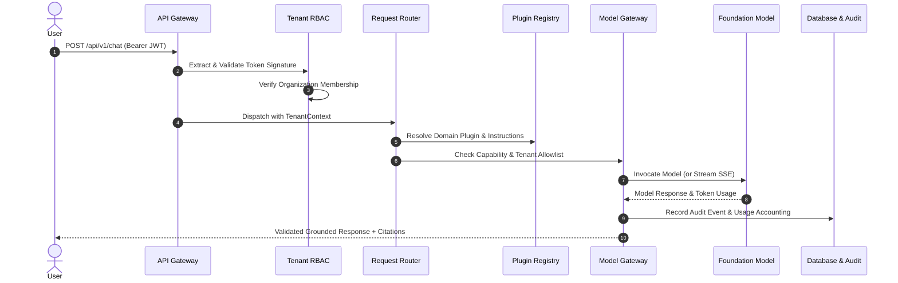

# UniMind Data Flow & Execution Pipelines

## 1. Tenant-Aware Request Flow

## 2. Document Ingestion Pipeline

1. **Upload**: Client sends multipart file to `/api/v1/knowledge-bases/{kb_id}/documents/upload`.
2. **Validation**: Enforces allowed extensions (`.pdf`, `.txt`, `.md`, `.docx`) and size limits (< 50MB). Sanitizes filenames to eliminate directory traversal.
3. **Storage**: Saves file to isolated tenant directory path: `./storage/uploads/{org_id}/{workspace_id}/{doc_id}_{filename}`.
4. **Extraction**: `DocumentExtractor` parses text and page boundaries (using `pypdf` for PDF files).
5. **Chunking**: Splits pages into overlapping segments (e.g. 500 characters with 80 character overlap) preserving source filename and page numbers.
6. **Embedding & Indexing**: Generates dense semantic vector embeddings and stores records in `VectorStore` tagged with `org_id`, `workspace_id`, and `knowledge_base_id`.
7. **Status Update**: Updates `Document.status` to `indexed` and records `chunk_count`.
