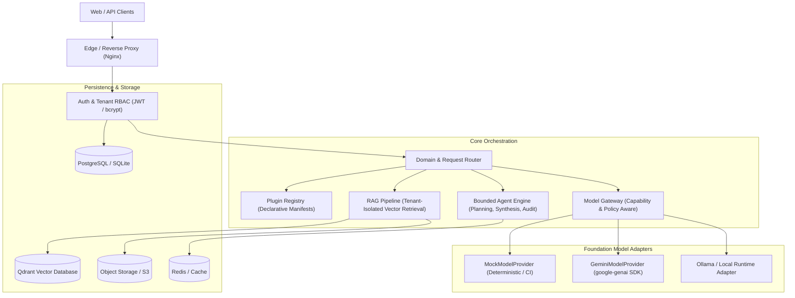

# UniMind Architecture Overview

## 1. System Vision
UniMind is a production-oriented, multimodal AI orchestration platform. It separates domain intelligence into declarative versioned plugins while unifying foundation model routing, retrieval-augmented generation (RAG), and stateful agent execution behind clean modular contracts.

## 2. Architectural Blueprint

## 3. Core Principles
- **Strict Multi-Tenancy**: Every database query, vector search, file path, and audit event is parameterized by `org_id` and `workspace_id`.
- **Capability-Aware Gateway**: Foundation models declare supported modalities and token limits. Requests specify requirements rather than hardcoding vendor names.
- **Declarative Extensibility**: Adding new domains (Education, Finance, Engineering, Biotech) requires only authoring a YAML manifest and instructions, with zero core pipeline modifications.
- **Untrusted Inputs**: Uploads, external APIs, and model outputs are treated as zero-trust payloads.
